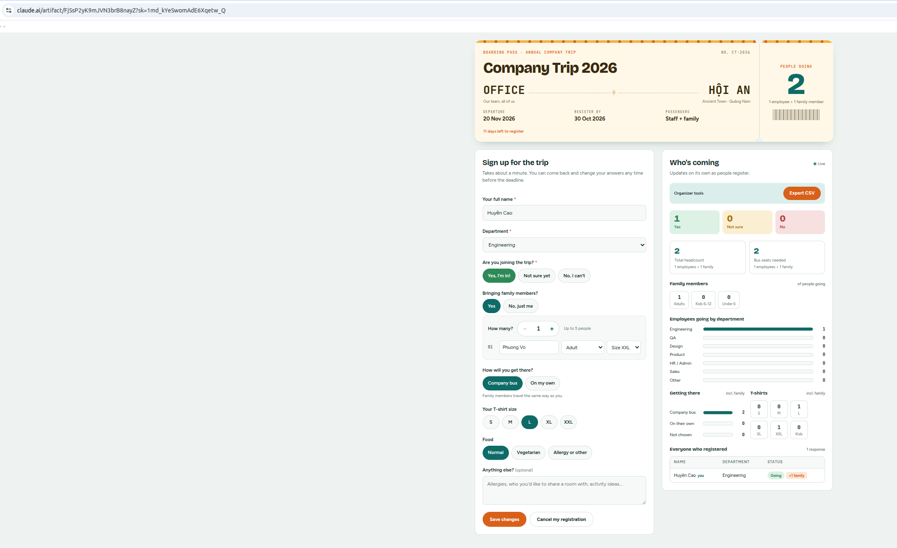

# Company trip registration form

**Exercise:** write one detailed prompt that has Claude build and publish a shareable app as a claude.ai artifact, then check what it built.

- Artifact: <https://claude.ai/artifact/FjSsP2yK9mJVN3brB8nayZ> (private until shared)
- Date: 2026-10-20

## The prompt

```text
I'm organizing our company's annual trip for about 60 employees and their
families, and I need a registration form that everyone can fill in quickly
on their phone. Most people are not technical, so keep the wording friendly
and simple.

Create a company trip registration form and publish it as an artifact
that I can share with the whole company.

Trip info (show at the top, styled like a travel ticket):
- Title: Company Trip 2026
- Destination: Hoi An
- Dates: 20/11
- Registration deadline: 30/10/2026
- A big counter showing the total number of people going
  (employees + family members)

Form fields:
- Full name (required)
- Department (required, dropdown): Engineering, QA, Design, Product,
  HR / Admin, Sales, Other
- Joining the trip? (required, chip buttons): Yes / Not sure / No
- Bringing family members? Yes / No
  - If Yes, show a number stepper (- / +) for how many, from 1 to 5
  - For each family member, show a small row with:
    - Name (optional)
    - Age group: Adult / Child (6-12) / Under 6
    - T-shirt size: S, M, L, XL, XXL, Kids
  - Rows are added or removed automatically when the number changes
  - Hide this whole section if the person selects "No" for joining
- Transportation: Company bus / On my own
- T-shirt size: S, M, L, XL, XXL
- Diet: Normal / Vegetarian / Allergy or other
- Notes (optional, e.g. allergies, room sharing requests, activity ideas)

Data and permissions:
- Save responses in the artifact's shared database (not localStorage),
  so everyone's responses are stored in one place, like Google Forms
  saving to a Google Sheet.
- One response per person, keyed by their user id. People can edit
  or cancel their own response, but not anyone else's.
- Store family members inside the same response as a list.
- Everyone who opens the page can see the stats and the list of names.
- Only me (the owner) gets an "Export CSV" button that downloads all
  responses (make it open correctly in Excel, with UTF-8 BOM).
  Include columns for number of family members and their details.
- If a viewer only has view access, show a clear message that they
  need Contributor access to register.

Live stats panel next to the form (updates in real time):
- Count of Yes / Not sure / No
- Total headcount = employees going + family members
- Family breakdown: adults / children 6-12 / under 6
- Employees going by department (bar chart)
- Transportation and T-shirt size breakdown, including family members' sizes
- Bus seats needed = employees + family members choosing the company bus
- Table of everyone who registered, with a colored status pill and
  a "+N family" badge
- A friendly empty state when nobody has registered yet

Design:
- Clean, modern, travel-inspired, not generic. Two columns on desktop,
  one column on mobile.
- Support both light and dark mode.

After publishing, tell me where the data is stored and how to share
the form so teammates can submit responses.
```

## UI


